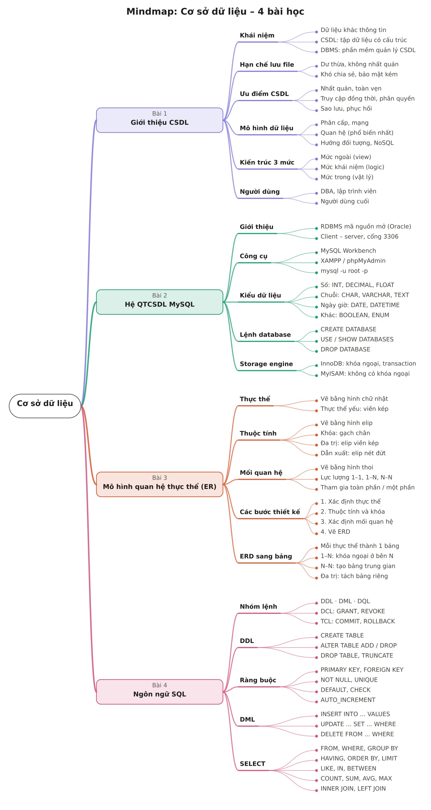

# Hệ thống kiến thức Mindmap: Cơ sở dữ liệu

Mindmap tổng hợp kiến thức của 4 bài học, đi từ tổng quan đến chi tiết:

1. **Bài 1:** Giới thiệu về Cơ sở dữ liệu
2. **Bài 2:** Giới thiệu về Hệ quản trị CSDL MySQL
3. **Bài 3:** Xây dựng mô hình quan hệ thực thể (ER)
4. **Bài 4:** Giới thiệu ngôn ngữ SQL trong CSDL

[Xem mindmap tương tác trên MindMeister](https://mm.tt/app/map/4121155140?t=OnuOkag1Cd)

## Nội dung chi tiết

### Bài 1 · Giới thiệu CSDL
- Khái niệm
  - Dữ liệu khác thông tin
  - CSDL: tập dữ liệu có cấu trúc
  - DBMS: phần mềm quản lý CSDL
- Hạn chế lưu file
  - Dư thừa, không nhất quán
  - Khó chia sẻ, bảo mật kém
- Ưu điểm CSDL
  - Nhất quán, toàn vẹn
  - Truy cập đồng thời, phân quyền
  - Sao lưu, phục hồi
- Mô hình dữ liệu
  - Phân cấp, mạng
  - Quan hệ (phổ biến nhất)
  - Hướng đối tượng, NoSQL
- Kiến trúc 3 mức
  - Mức ngoài (view)
  - Mức khái niệm (logic)
  - Mức trong (vật lý)
- Người dùng
  - DBA, lập trình viên
  - Người dùng cuối

### Bài 2 · Hệ QTCSDL MySQL
- Giới thiệu
  - RDBMS mã nguồn mở (Oracle)
  - Client – server, cổng 3306
- Công cụ
  - MySQL Workbench
  - XAMPP / phpMyAdmin
  - mysql -u root -p
- Kiểu dữ liệu
  - Số: INT, DECIMAL, FLOAT
  - Chuỗi: CHAR, VARCHAR, TEXT
  - Ngày giờ: DATE, DATETIME
  - Khác: BOOLEAN, ENUM
- Lệnh database
  - CREATE DATABASE
  - USE / SHOW DATABASES
  - DROP DATABASE
- Storage engine
  - InnoDB: khóa ngoại, transaction
  - MyISAM: không có khóa ngoại

### Bài 3 · Mô hình quan hệ thực thể (ER)
- Thực thể
  - Vẽ bằng hình chữ nhật
  - Thực thể yếu: viền kép
- Thuộc tính
  - Vẽ bằng hình elip
  - Khóa: gạch chân
  - Đa trị: elip viền kép
  - Dẫn xuất: elip nét đứt
- Mối quan hệ
  - Vẽ bằng hình thoi
  - Lực lượng 1–1, 1–N, N–N
  - Tham gia toàn phần / một phần
- Các bước thiết kế
  - 1. Xác định thực thể
  - 2. Thuộc tính và khóa
  - 3. Xác định mối quan hệ
  - 4. Vẽ ERD
- ERD sang bảng
  - Mỗi thực thể thành 1 bảng
  - 1–N: khóa ngoại ở bên N
  - N–N: tạo bảng trung gian
  - Đa trị: tách bảng riêng

### Bài 4 · Ngôn ngữ SQL
- Nhóm lệnh
  - DDL · DML · DQL
  - DCL: GRANT, REVOKE
  - TCL: COMMIT, ROLLBACK
- DDL
  - CREATE TABLE
  - ALTER TABLE ADD / DROP
  - DROP TABLE, TRUNCATE
- Ràng buộc
  - PRIMARY KEY, FOREIGN KEY
  - NOT NULL, UNIQUE
  - DEFAULT, CHECK
  - AUTO_INCREMENT
- DML
  - INSERT INTO ... VALUES
  - UPDATE ... SET ... WHERE
  - DELETE FROM ... WHERE
- SELECT
  - FROM, WHERE, GROUP BY
  - HAVING, ORDER BY, LIMIT
  - LIKE, IN, BETWEEN
  - COUNT, SUM, AVG, MAX
  - INNER JOIN, LEFT JOIN
