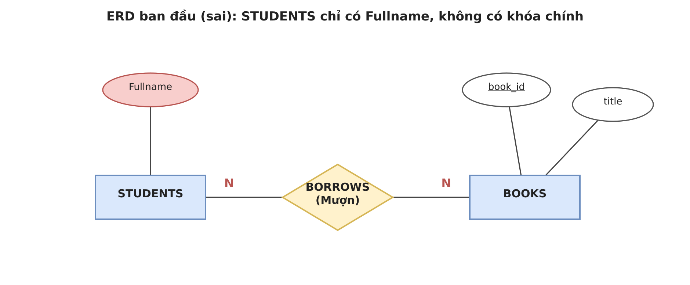
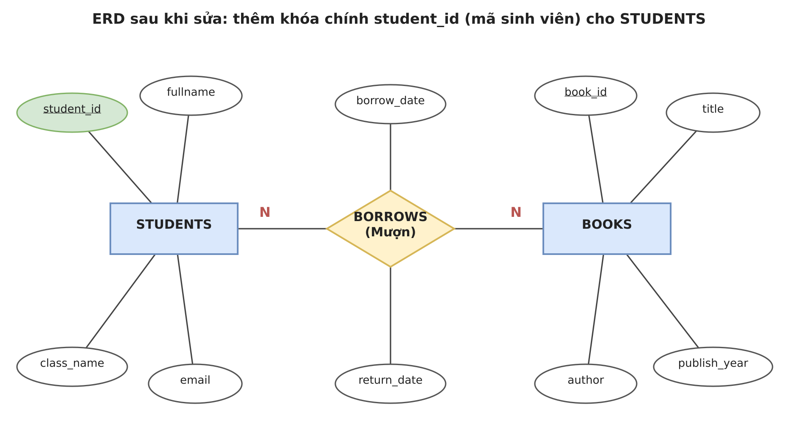

# Bài tập: Sự cố "Lạc trôi" sinh viên và Bẫy khóa chính

## 1. Phân tích

Trong bản thiết kế nháp, thực thể STUDENTS chỉ có thuộc tính **Fullname** và không có thuộc tính nào được gạch chân, tức là **không có khóa chính**.

**Vi phạm tính toàn vẹn (Bài 1).** Tính toàn vẹn thực thể yêu cầu mỗi bản ghi phải được xác định **duy nhất** và không được để trống. Họ tên không đảm bảo điều này, vì trong trường hoàn toàn có thể có hai bạn cùng tên "Nguyễn Văn A". Hệ thống sẽ coi hai người này là một, và dữ liệu bị gộp lẫn, sai lệch.

**Sai nguyên tắc ERD (Bài 4).** Mỗi thực thể mạnh phải có một **thuộc tính khóa** (được gạch chân) để phân biệt các thể hiện của nó. Thiếu khóa thì mối quan hệ BORROWS không biết đang nối tới **sinh viên nào**. Khi chuyển sang bảng, bảng mượn sách cũng không có gì để làm khóa ngoại tham chiếu tới STUDENTS.

**Hậu quả thực tế:**
- Không biết ai đang mượn sách và ai đã trả. Sách do một "Nguyễn Văn A" mượn có thể bị tính cho "Nguyễn Văn A" kia.
- Sửa hay xóa thông tin của một bạn sẽ ảnh hưởng luôn bạn trùng tên.
- Họ tên có thể bị gõ sai hoặc thay đổi (ví dụ đổi tên), nên dùng làm định danh lại càng không ổn định.

## 2. Bản vẽ sau khi sửa

Thêm thuộc tính **<u>student_id</u>** (mã sinh viên, in trên thẻ sinh viên) vào STUDENTS và **gạch chân** để đánh dấu đây là khóa chính. Mã sinh viên do nhà trường cấp, **không trùng** và **không đổi**. Nhờ vậy, dù hai bạn trùng tên thì mỗi người vẫn là duy nhất trong hệ thống.

- **STUDENTS:** <u>student_id</u> (khóa chính), fullname, class_name, email
- **BOOKS:** <u>book_id</u> (khóa chính), title, author, publish_year
- **BORROWS (Mượn):** mối quan hệ **N–N**, có thuộc tính borrow_date và return_date. Một sinh viên mượn nhiều sách, và một cuốn sách được nhiều sinh viên mượn qua các lần khác nhau.

## 3. Chuyển sang bảng

| Bảng | Cột |
|---|---|
| STUDENTS | **student_id** (PK), fullname, class_name, email |
| BOOKS | **book_id** (PK), title, author, publish_year |
| BORROWS | **borrow_id** (PK), student_id (FK → STUDENTS), book_id (FK → BOOKS), borrow_date, return_date |

Lúc này mỗi lượt mượn đều gắn với đúng một `student_id`, nên thư viện luôn biết chính xác ai đang giữ sách.

## File trong repository

- `erd-sau-khi-sua.png`: ảnh ERD đã sửa, thuộc tính mới thêm được tô xanh.
- `erd-ban-dau-sai.png`: ảnh ERD ban đầu, để so sánh.
