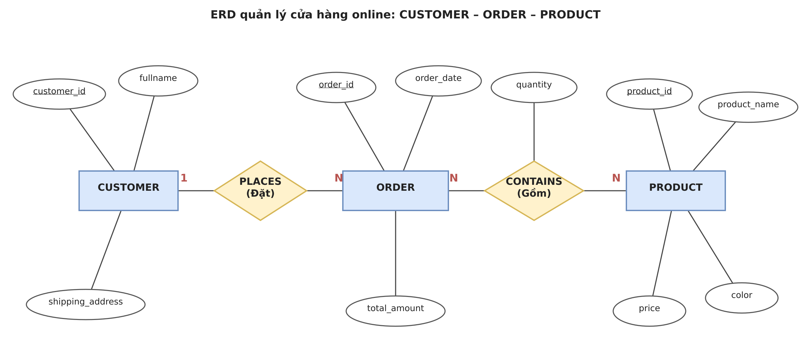

# Thực hành tổng hợp: Thiết kế sơ đồ ERD Quản lý Cửa hàng Online

## 1. Sơ đồ ERD (mô hình Chen)

[Mở sơ đồ trên draw.io](https://app.diagrams.net/#RzZndbts2FMdfRfCAYrtIre%2FYUxQgc4JuwJoUcYpdBrRIfSAUqVJUbfeqj1CgL1Bg17su0KJX3YtkTzJSkiU5UQDBlgvlIuCHJP9%2F5xwdHlIn8cqPMFJCmnJ3BJLkOYxAwECcPieIj05Pyq5CQIzc0cX1%2BZGXgaMQkOCIEhwRNFIi2D5xehKvXjCQhC8pRFiBK3ekqao6UuDaHdmyETB5r1Y05tE7JK8QvSyCKM0nOKWYR0nR8SghyON5GzBGl8WwT3HxlAQEqGrMPYDr3l8R5OHm9%2BXA7ygKQl7qiIGcFI00BJAuZfP0hFHKJcIMYZwzqqPxVj9%2FNEOEP57iEcfCMm8BzgqrKW%2By%2By9%2FEwV%2F%2F6Z491%2F%2FAUr4%2FRMJlMJUvyqz1%2FObq5cX18p%2F7z8qV9fnZevV9dX569mNEMbXkoajFXdCHmNXcwCOAuJ64vcRc3xK%2BDy%2FRiva0pia7QgNiIm7ttRqhWsQjRFna2WVo6%2Fz%2F8vSTrohOmFpI9kGwtZBeYeEHRe0W9RelnJxBavAN1SVfkYzAhF0VWcZRhzNE%2BAhdyliZAMlghHPKKbM%2FQkCNPE9J%2BWM3qFyzPYmaOE%2FQWt1pdX0gle3G8RWA9juCJxgoT%2BtcF%2F9eTa7mD%2FD3FmwZwF3fv73w%2F2Xz%2FyXGj%2Bk8SJLO8D7vq97D%2BChvbAt%2Bwl4syu8oVsFvGnV8GYDftoRnjLYcHUeswPzs9XmZ3sHP4vEw0FEak%2FPri5vzv64bPr6xf3Xj%2FGwXH1stLja2sHVCaMw83gd6A%2FS0jDcPbV6eq09rSKVDs6kfze57TaCcmycD1YGEHeKRQo9iV%2FBGF1hytDNU1XbW2raHVn0isXPMJbL%2BAFVa5NSttpcS3aRbVSy0zBKkogEtwBChtL0gPLNQr1pNtRPdlBPWwIoT5c%2FKnrM8lXQtD39QOvwKQAg4IcMoLwcexhAxi7C6wDilAN8C2KRpPgBpVvlwprbvi39dJV%2BV0fPmwwQUUuuDyj72LQeh8ouFk9agr5cOH5U2E%2FbsuZOLHXYbxAOnTlVu9Ru7hk%2BidHQHnmHFD011Mchr%2B2i2aw0e7IkOKihj0vRxp6ikVqJrvUSeCZ3pi6hBG2pbKlrZLusgBYTSxjRwWCB8G%2FAuwvykqquEMWfAESw2uBu8JSUZsxDRdHCAQsQb2zEtuAZwoBHb4sndALUBgWo9w%2BoDwrQ6B%2FQGBIgbYRosXvck84cFJ3eM501KDqjZzp7SHR3zeS52ezvCXg8JMCkAbjZze%2FJNxkUn94733RQfEbvfNqgyhdZAfYNWJcv2hCW9%2Bp0vOIsjo%2F3xayLmMshOLI8E%2B91sdCMQTGWR999rxiaOSjK%2BtS7hxdzXHxOGzc%2FCYpu%2BXkxn5AfIk%2F%2FBw%3D%3D)

## 2. Thực thể và thuộc tính

Thực thể được vẽ bằng **hình chữ nhật**, thuộc tính bằng **hình oval**, và khóa chính được **gạch chân**.

| Thực thể | Khóa chính | Thuộc tính |
|---|---|---|
| PRODUCT (Sản phẩm) | <u>product_id</u> (Mã sản phẩm) | product_name (Tên sản phẩm), price (Giá tiền), color (Màu sắc) |
| CUSTOMER (Khách hàng) | <u>customer_id</u> (Mã khách hàng) | fullname (Họ tên), shipping_address (Địa chỉ giao hàng) |
| ORDER (Đơn hàng) | <u>order_id</u> (Mã đơn hàng) | order_date (Ngày đặt), total_amount (Tổng tiền) |

Khóa chính được chọn là các mã định danh, vì những thuộc tính còn lại đều có thể trùng nhau: hai khách hàng có thể cùng họ tên, hai sản phẩm có thể cùng tên hoặc cùng giá. Chỉ mã mới đảm bảo mỗi bản ghi là duy nhất.

## 3. Mối quan hệ

| Mối quan hệ | Nối giữa | Lực lượng | Giải thích |
|---|---|---|---|
| PLACES (Đặt) | CUSTOMER – ORDER | 1 – N | Một khách hàng đặt nhiều đơn hàng, mỗi đơn hàng thuộc về một khách hàng |
| CONTAINS (Gồm) | ORDER – PRODUCT | N – N | Một đơn hàng gồm nhiều sản phẩm, một sản phẩm có trong nhiều đơn hàng. Thuộc tính **quantity** (số lượng) gắn vào mối quan hệ này |

## 4. Chuyển sang bảng

| Bảng | Cột |
|---|---|
| PRODUCT | **product_id** (PK), product_name, price, color |
| CUSTOMER | **customer_id** (PK), fullname, shipping_address |
| ORDERS | **order_id** (PK), customer_id (FK → CUSTOMER), order_date, total_amount |
| ORDER_DETAILS | **order_id** (FK → ORDERS), **product_id** (FK → PRODUCT), quantity; PK = (order_id, product_id) |

`ORDER` là từ khóa của SQL (dùng trong `ORDER BY`), nên khi tạo bảng thực tế nên đặt tên là `ORDERS` để tránh lỗi cú pháp.
