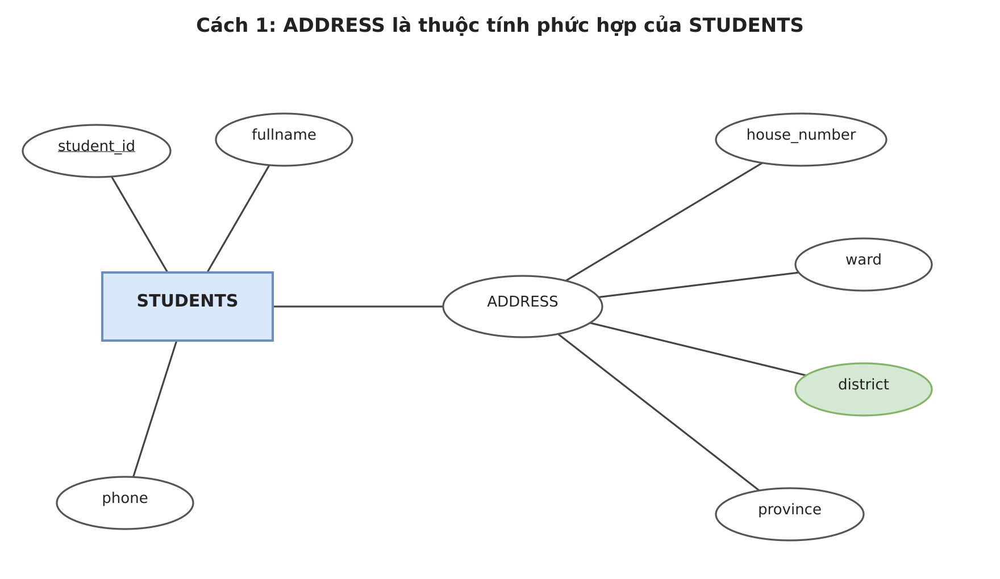
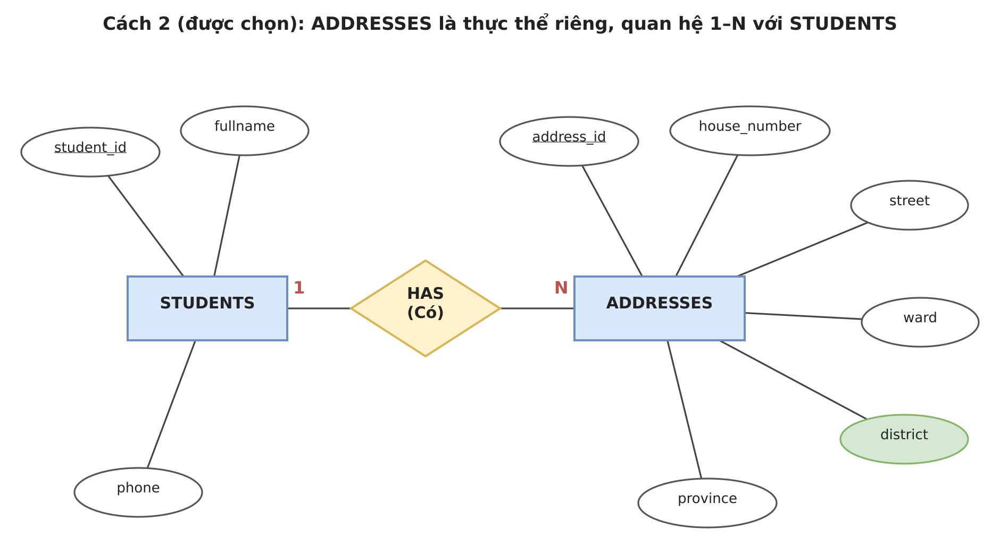

# Bài tập: Tối ưu kiến trúc cho Dịch vụ Giao sách tận nhà

## 1. Phân tích và đề xuất

Nếu ADDRESS chỉ là một chuỗi văn bản dài (ví dụ "Số 1, đường X, Phường Y, Quận 1, TP.HCM"), máy tính không tách được phần "Quận" ra để lọc. Muốn gom đơn theo quận thì phải đọc từng dòng bằng mắt, và chỉ cần gõ khác nhau ("Q1", "Quận 1", "quận 1") là lọc sai. Vì vậy địa chỉ phải được **phân rã thành các thành phần nhỏ**. Có 2 cách vẽ:

### Cách 1: ADDRESS là thuộc tính phức hợp của STUDENTS

ADDRESS vẫn là một hình oval gắn vào STUDENTS, nhưng tách thành các oval con: **house_number** (số nhà), **ward** (phường), **district** (quận), **province** (tỉnh/thành).



[Mở sơ đồ Cách 1 trên draw.io](https://app.diagrams.net/#RzZjdbtMwFMdfxQrS7ljzTSFNpbFNcAMXZIjLyY1PE2tOHDnO2vIm3IG4QFzwBLvck%2BxNsJMsSbVNKmuL2ovo%2BDP%2F3%2FHxcdxJtpxTBijlpQwNXBTHhOJE4Kw8zkEa00lbRDnOIDROcZy%2BtAxESWdPJ9nyncBF%2BoETYIgsQ8MyTdNAZBUavjYSobtbjRHRr6B7qFJFCZR1g%2BScSVo0hZjnOcSytrEQfNFUzzlrZilwAp0RxZj1pS%2BUyPT%2B%2FbriPdAkla2ODOtGZZQpJnyhzelEcC41wikwVmOZxmitXE8tIJcPmySVDAx0jVmlfXP7I06R9QadnJ19Oo8ixG6%2FI5lWdzffYiRv%2F%2BQpKtK7m98xUs%2BfBYrvbn5hFF18Pjv%2FeBEpVXKlUSQsZZDKjIVWgBlN8jBWLwcRzHkuo7qP1djak5YfKAEg1Kg1qe26AM9AihVa1tyr%2BrlonDQeKztt%2FeMoGys%2FJ%2B0ADTpqSNeIS1kRNX%2FZQT%2BQL3iVEyChGSxSKiEqcAzhQsXHPZMKN3bKGRfhC4JhPI%2BDUgp%2BBW2dH49hNn8C1tsU9nVDa7s9r%2BUNeP1Nea2O9IjJoDpKZND64JISXTWq6zp8NVDFMTwJ36E4m6LYDYplDVCcAYrrb4hidyjzijG9n%2Feo2mpXwDIHsu3nyHY62UXK831q9hrJrr2lZEyI6ES3yWCPsp0u2J1etzvQ7bkb6u6DPeVVCZd5lc1A7FG67zwSJd5zXN4H9wILskfJr8zW29a2UdIHNqEqBdJYPkf2MJ16MCbuejod2zPH99fS6T%2BCOltvB7ffwYJf0zyG%2FxBSrrNlvgSzk93LzcmJ%2FiIJc5WJ1kQ%2BclRpu12F2dhzPTNgeAbsLY6vkvqUbBvn9U%2FxAek%2BbO7pUMkroZxSH0QSiwTk4BBeYxfAsKTXzQwbAVoHBWjvHtA%2BKEBn94DOIQE2x96uEd2DQhzswhp3SzjvoODs3cL5BwXn7Bbu1UHBudvDjZqL8Gh4mVfF9vpfN%2Bg%2FCqZ%2FAQ%3D%3D)

### Cách 2: Tách ADDRESSES thành thực thể riêng

ADDRESSES là một hình chữ nhật riêng, có khóa chính **address_id** cùng các thuộc tính house_number, street, ward, district, province. ADDRESSES nối với STUDENTS qua mối quan hệ **HAS (Có)** theo tỷ lệ **1–N**: một sinh viên có thể có nhiều địa chỉ nhận sách (nhà riêng, ký túc xá...).



[Mở sơ đồ Cách 2 trên draw.io](https://app.diagrams.net/#RzZi%2Fb%2BM2FMf%2FFUIFDndA72z9jF1FAdIk6C3NcLpDxwMtPknEUaJLUbHTqUCHTh2Kjl1adOvUQ8eMKfp%2FpH9JSUmW7CYBBDsq5MF%2BJCX6%2B3nvkY%2FgcbaOKQOU8kIGBl4uXxGKE4Gz4lUO0jg5bpooxxkExhmO0peWgShp7ZPjbP2FwMv0S06AIbIODHM6nRqIXAeGp41E6MfN2gjpN6CfUK2SEiiqAck5k3RZNyKe5xDJysZC8FXdHXNWz7LECbRGGGHWtb6iRKab%2F9cdr4EmqWx0ZFgPKqNIMeErbZ4cC86lRjgDxiqsqTHZaVdTC8jl%2FSFJJQMDXWFWat%2Fc%2FhqlyELP%2F%2Frx7z%2Fubn6LUJTe3fyQv%2FgMnZ6fv7kIw4sQsdtfkFTdH6Pq5zsk6O3vefIp%2BrrEOVI93yPzn29%2FukRXdzc%2FUxS%2BfXd%2Bcfk2VJrltQaVsJZ%2BKjMWmD5mNMmDSEkD4cc8l2H1jFnb2s%2Bm5yt5INRbOyBmHTXgGUhxjdaVV66r71Xtwrmj7LTxnq1srKKQNC9oN0xqP%2Bz4o5AlUfMXrUvuyRe8zAmQYOqvUiohXOIIgpXKng2TSkZ2xhkXwScEwyyO%2FEIK%2FgGaPi%2BawSJ%2BBNbtC2taNa7ldcCmuwXs9QROccf6%2BjR8xqS%2FEM8S6T8%2Fu%2F3zRUed8mxRFj2Y4zi2ov8wE2%2Fhud4jzE5fZttumB23Y94O8rwnMyZEQFFAR95m98jC7DoPhNnbI8yF2bLqEJc6wk2uv6dEd02qvpZfvah2M3iUvmWx%2B7I0GVtl7gbF3kJxvJ4oVosSl4zpXX1A1eZRI3u6JdvaR7bdyl6mPB9ScyPZcQ6UjKf3k6ZZO%2F9X0jgb95sHZg3uFkDKywLe52W2ADGgdM9%2BIHPcfaS7rXS1xYA60wwnejZtRB9tiTb3Ed2t0hUWZEjJZrNHzg6V3K1QQpWnabSXp7cLgwsz4uwWhpm1sL3dWth3Wc9rUHt%2B6Lp2uq1I8CuaR0PuRl6TUo574BKGbjvq5ObkVB%2Bwg1xtqTsiHyi62m6isJi5So%2FP8ALY5zj6kFT1vjvCqI%2FiA9Ke0zd0qOCliKCuqBKLBOTWqXGHXQDDkl7VM%2FQCNEcFaD09oDUqQPvpAe0xAer6vQHszrwHEjqjIjQHIHRHRegOQOiNitAagPBoVIT2AISzURE6AxDOW0JzDNWivRnagOqrk0MLfnekuRwBY3UZ9CRxnNSXkpPti1XVbK5iqwF9aXvyLw%3D%3D)

## 2. So sánh

| Tiêu chí | Cách 1: Thuộc tính phức hợp | Cách 2: Thực thể riêng |
|---|---|---|
| Độ dễ khi vẽ | **Dễ hơn**: chỉ thêm các oval con, không cần mối quan hệ hay khóa mới | Phức tạp hơn: thêm thực thể, khóa chính, mối quan hệ và lực lượng 1–N |
| Tìm kiếm riêng theo "Quận" | Lọc được, vì district là một cột riêng trong bảng STUDENTS | **Tốt nhất**: lọc ngay trên bảng ADDRESSES, gom được tất cả địa chỉ cùng quận, kể cả khi một sinh viên có nhiều địa chỉ |
| Một sinh viên có nhiều địa chỉ | Không hỗ trợ, mỗi sinh viên chỉ có 1 địa chỉ | Hỗ trợ: thêm địa chỉ mới chỉ là thêm một dòng vào ADDRESSES |
| Mở rộng sau này | Khó: thêm thông tin cho địa chỉ (tọa độ, ghi chú giao hàng) sẽ làm bảng STUDENTS phình to | Dễ: thêm cột vào ADDRESSES mà không ảnh hưởng STUDENTS |

## 3. Thiết kế: chọn Cách 2

Mình chọn **Cách 2** vì đây là cách giúp shipper làm việc dễ nhất:

- **Gom đơn theo quận:** district là một thuộc tính riêng của ADDRESSES, nên hệ thống lọc ngay được danh sách "các địa chỉ ở Quận 1" để giao cho một shipper, không cần đọc từng dòng.
- **Giao đúng nơi sinh viên muốn nhận:** sinh viên có thể có nhiều địa chỉ, và mỗi đơn giao chọn đúng một address_id.
- **Tính phí ship theo quận:** thông tin quận nằm tách riêng, chuẩn hóa, nên dễ gắn bảng giá theo quận về sau.

Khi chuyển sang bảng:

| Bảng | Cột |
|---|---|
| STUDENTS | **student_id** (PK), fullname, phone |
| ADDRESSES | **address_id** (PK), student_id (FK → STUDENTS), house_number, street, ward, **district**, province |

Ví dụ lọc danh sách giao hàng ở Quận 1:

```sql
SELECT s.fullname, s.phone, a.house_number, a.street, a.ward
FROM ADDRESSES a
JOIN STUDENTS s ON s.student_id = a.student_id
WHERE a.district = 'Quận 1';
```
