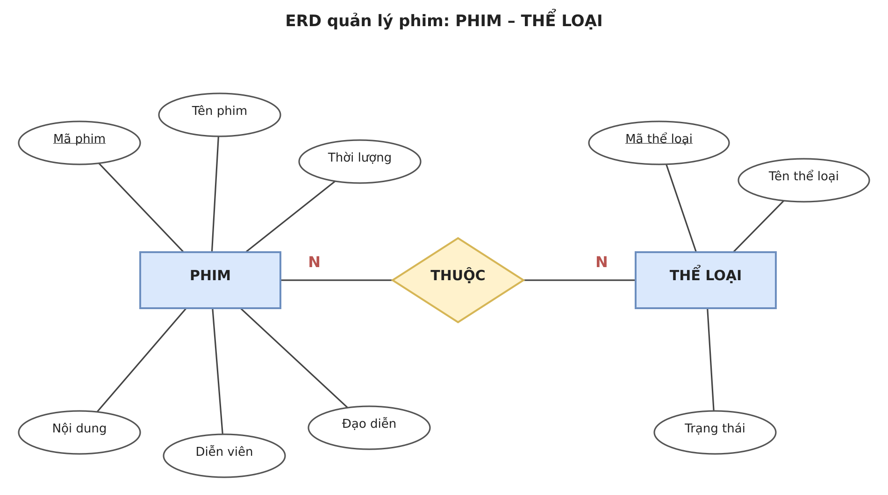

# Thực hành: Thiết kế Mô hình Dữ liệu Quản lý Phim

## 1. Sơ đồ ERD (mô hình Chen)



[Mở sơ đồ trên draw.io](https://app.diagrams.net/#RzZhNb9MwGMe%2FihWk3bYmzctaskyCDbFJDBAb4uwmbmLNsTvXWVtOCMQdiQsckEC7ceK8itMQ3yN8EpyXJulopWpNUXqoHttx8v89j%2F34ZS8c9zFBIGBD4ShwMNjxMPQ5DIc7FAllfy8vAgpD5CiPXhxuX0SQbpPJ9iDAoQKwt6B2fy8cP%2BZwEJwwDxHgjR1FU1VVAd7EUazE8HnSUcuMU%2FwaJU%2FIUoQ9NEwbBGNE4EFWcBmlyBWpDTlno6y6z0j2lgH0UWGcupCUpVfYE8Hs%2B0nFEcJ%2BIHIdIUwapTEMoMdGibm%2FxxkTCcIBIiQFVJXWXDl9NUdU%2FNsksCBIAZeQRJm%2FwEUUX19RQG5%2BgsQ598Hzo%2BMT8OfNR3B2FE%2FfgifP4uuvx1KBmCSyBRoLOxAhcTQbEuxTx5UfQtzuMypO02e0zE68plm2%2FBjistecLC2LAWIhEnwCxinjJP0fZQ7pmtIOcl%2Fo0obSp37eIYFqZVRzdFnMc7iEo5DNWUQ95DmqPQqwQKcD6CJnJMfAjEUOM3LACOPOPQ%2BiTt%2B1h4Kzc5TXWW4H9fpLIM1VITUzw2zvlqBaFdRaEVQEEXML0rOjl%2FH000EJG7CwFw1XQO33%2B233Fqpn9SzTWoJqrIpqtHNU0yxRjQpqd1VUUuFcMCCbEVmrU1NkB1qBu0WEHW35wj65uUrnZlLRSmsKetlNJiG0lL0g0VclyeOm6RUQvQJiWCuCtMu43XynIJubG5Ot7ea61XV166XuIJ5%2BwYD8%2FhFPr6i%2FQfX6zOvmuuqNQv3TePoZAy%2FaqPBct2Gsq9ssdB%2FiePqegkssR81GB4yZSbfMNaVbhfRfH%2BLrbwx4KcEmh4ueu11fU7tYkm2EHPnvAGESB%2F%2BXrGPpC9KOeReiW2mnSrJB%2FbvdXH81%2Fxt30V9JP1yKpr5EuNmsdrWmSYzUQnspl3oPkh2xQxlFcyIXLLaJnS%2FLvY5pmKpNYA%2BRh9A999N1vty2yJ%2FkQ16xsZ7RgSGLuHRKupIKyH0k8o3hHDdHBAp8mfVeCU5rFFy7Xrh2o%2BD0euH0RsEZ9cIZjYIz64UzGwVn1QtnNQlOVLKlPHKtibbbKLR2nWidRqHpdaJ1y7NDE6ZbemAs6NIbj3WXcLVRhPktznoBbGXXga3qlaYs5hejaUNyhbr%2FFw%3D%3D)

## 2. Thực thể và thuộc tính

Thực thể được vẽ bằng **hình chữ nhật**, thuộc tính bằng **hình oval** nối với thực thể bằng connector, và khóa chính được **gạch chân**.

| Thực thể | Khóa chính | Thuộc tính |
|---|---|---|
| PHIM | <u>Mã phim</u> | Tên phim, Thời lượng, Nội dung, Diễn viên, Đạo diễn |
| THỂ LOẠI | <u>Mã thể loại</u> | Tên thể loại, Trạng thái |

**Vì sao chọn các khóa chính này:** Mã phim và Mã thể loại là các giá trị do hệ thống cấp, **không bao giờ trùng nhau**. Các thuộc tính khác đều có thể trùng: hai bộ phim có thể cùng tên (phim làm lại), cùng thời lượng hoặc cùng đạo diễn, nên không dùng để định danh được.

## 3. Mối quan hệ

| Mối quan hệ | Nối giữa | Lực lượng | Giải thích |
|---|---|---|---|
| THUỘC | PHIM – THỂ LOẠI | N – N | Một phim có thể thuộc nhiều thể loại (ví dụ vừa Hành động vừa Khoa học viễn tưởng), và một thể loại có nhiều phim |

Khi chuyển sang bảng, quan hệ N–N cần một bảng trung gian:

| Bảng | Cột |
|---|---|
| PHIM | **ma_phim** (PK), ten_phim, thoi_luong, noi_dung, dien_vien, dao_dien |
| THE_LOAI | **ma_the_loai** (PK), ten_the_loai, trang_thai |
| PHIM_THE_LOAI | **ma_phim** (FK → PHIM), **ma_the_loai** (FK → THE_LOAI); PK = (ma_phim, ma_the_loai) |

### Code SQL tạo bảng (MySQL)

```sql
CREATE DATABASE IF NOT EXISTS quan_ly_phim CHARACTER SET utf8mb4;
USE quan_ly_phim;

CREATE TABLE PHIM (
  ma_phim     VARCHAR(10)  PRIMARY KEY,
  ten_phim    VARCHAR(255) NOT NULL,
  thoi_luong  INT          NOT NULL COMMENT 'Đơn vị: phút',
  noi_dung    TEXT,
  dien_vien   VARCHAR(500),
  dao_dien    VARCHAR(255)
);

CREATE TABLE THE_LOAI (
  ma_the_loai  VARCHAR(10)  PRIMARY KEY,
  ten_the_loai VARCHAR(100) NOT NULL UNIQUE,
  trang_thai   BOOLEAN      NOT NULL DEFAULT TRUE COMMENT 'TRUE: đang hoạt động, FALSE: ẩn'
);

CREATE TABLE PHIM_THE_LOAI (
  ma_phim     VARCHAR(10),
  ma_the_loai VARCHAR(10),
  PRIMARY KEY (ma_phim, ma_the_loai),
  FOREIGN KEY (ma_phim)     REFERENCES PHIM(ma_phim)         ON DELETE CASCADE,
  FOREIGN KEY (ma_the_loai) REFERENCES THE_LOAI(ma_the_loai) ON DELETE CASCADE
);
```

## 4. Tự kiểm tra

- [x] **Đúng ký hiệu:** thực thể nằm trong hình chữ nhật, thuộc tính nằm trong hình oval.
- [x] **Đúng cấu trúc:** mỗi oval được nối bằng connector vào đúng thực thể của nó.
- [x] **Định danh chính xác:** có thuộc tính gạch chân cho cả hai thực thể (<u>Mã phim</u>, <u>Mã thể loại</u>).
- [x] **Tính thẩm mỹ:** các khối hình xếp cân đối quanh thực thể, đường nối không cắt nhau, chữ không tràn khỏi hình.
