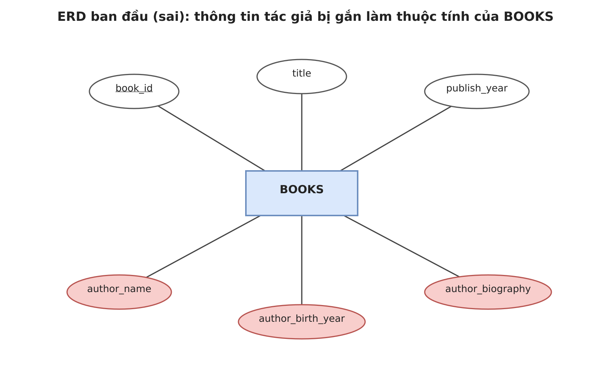
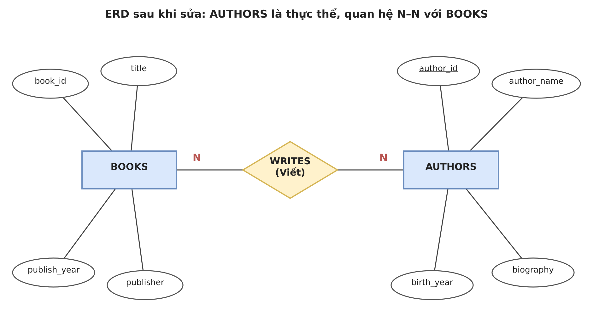

# Bài tập: Tối ưu hóa mô hình ERD – Thư viện số

## 1. Phân tích logic

**Yêu cầu nghiệp vụ:** khi bấm vào tên tác giả, sinh viên phải xem được năm sinh, tiểu sử và **các đầu sách khác** mà tác giả đó đã viết.

Bản thiết kế ban đầu coi AUTHORS là thuộc tính của BOOKS. Cách làm này sai vì những lý do sau:

- **Tác giả là một đối tượng độc lập, có thông tin riêng** (tên, năm sinh, tiểu sử). Thuộc tính chỉ nên mô tả một giá trị đơn lẻ của thực thể. Khi một "thông tin" lại có nhiều thuộc tính con và tồn tại độc lập, nó phải là một **thực thể**.
- **Dư thừa dữ liệu:** thông tin tác giả bị lặp lại ở mọi cuốn sách. Nguyễn Nhật Ánh có 100 cuốn sách thì tên, năm sinh và tiểu sử của ông bị lưu 100 lần.
- **Bất thường khi cập nhật:** cần sửa tiểu sử thì phải sửa ở 100 chỗ. Chỉ cần sót một chỗ là dữ liệu mâu thuẫn, mỗi cuốn hiển thị một tiểu sử khác nhau.
- **Bất thường khi thêm và xóa:** không thể lưu một tác giả chưa có sách nào. Ngược lại, xóa cuốn sách cuối cùng của một tác giả thì mất luôn thông tin về tác giả đó.
- **Không đáp ứng được nghiệp vụ và khó mở rộng:** muốn tìm "các đầu sách khác của tác giả" thì phải so khớp chuỗi tên. Cách này sai khi gõ nhầm tên hoặc khi hai tác giả trùng tên. Thiết kế này cũng không biểu diễn được sách có nhiều đồng tác giả, và khó thêm thông tin mới cho tác giả như quốc tịch hay ảnh đại diện.

## 2. Mô hình ERD sau khi sửa

- **BOOKS** (thực thể): <u>book_id</u> (khóa chính), title, publish_year, publisher
- **AUTHORS** (thực thể): <u>author_id</u> (khóa chính), author_name, birth_year, biography
- **WRITES / Viết** (mối quan hệ): **N–N**. Một tác giả viết nhiều cuốn sách, và một cuốn sách có thể có nhiều đồng tác giả.

Bây giờ thông tin mỗi tác giả chỉ được lưu **một lần**. Sửa tiểu sử chỉ cần sửa một chỗ, và danh sách sách của một tác giả lấy được chính xác thông qua mối quan hệ WRITES.

## 3. Chuyển sang bảng (mô hình quan hệ)

Vì WRITES là quan hệ N–N, cần thêm một bảng trung gian:

| Bảng | Cột |
|---|---|
| BOOKS | **book_id** (PK), title, publish_year, publisher |
| AUTHORS | **author_id** (PK), author_name, birth_year, biography |
| BOOK_AUTHORS | **book_id** (FK → BOOKS), **author_id** (FK → AUTHORS); PK = (book_id, author_id) |

## 4. Link vẽ Draw.io

- Link vẽ trước khi sửa: https://drive.google.com/file/d/1Gh-eGV0OJCyGOHMGrqRcNVVndrRPR1pf/view?usp=sharing
- Link vẽ sau khi sửa: https://drive.google.com/file/d/1hNb_8r_asMsU3HdObYfUffvBFzqOn4Fm/view?usp=sharing

## File trong repository

- `erd-sau-khi-sua.png`: ảnh ERD đã sửa.
- `erd-ban-dau-sai.png`: ảnh ERD ban đầu, để so sánh.
