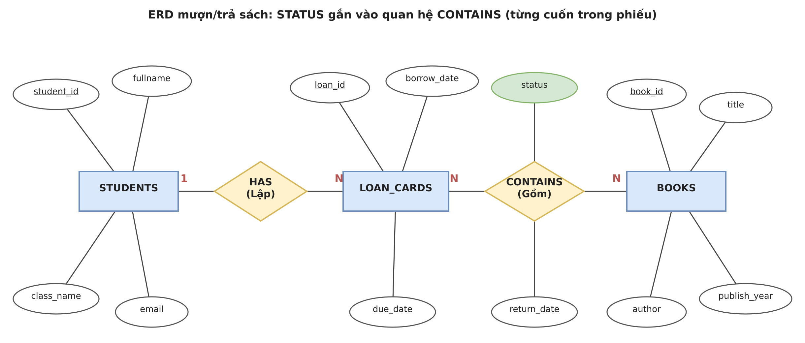

# Bài tập: Thiết kế ERD cho nghiệp vụ Mượn/Trả sách

## 1. Phân tích: Thực thể và Thuộc tính

**Thực thể (hình chữ nhật):**

| Thực thể | Thuộc tính (hình oval) |
|---|---|
| STUDENTS | <u>student_id</u> (khóa chính), fullname, class_name, email |
| LOAN_CARDS | <u>loan_id</u> (khóa chính), borrow_date (ngày mượn), due_date (hạn trả) |
| BOOKS | <u>book_id</u> (khóa chính), title, author, publish_year |

**Mối quan hệ (hình thoi):**

| Mối quan hệ | Nối giữa | Lực lượng | Thuộc tính của quan hệ |
|---|---|---|---|
| HAS (Lập) | STUDENTS – LOAN_CARDS | 1 – N | (không có) |
| CONTAINS (Gồm) | LOAN_CARDS – BOOKS | N – N | **status** (Đã trả/Chưa trả), return_date (ngày trả thực tế) |

- Một sinh viên có thể lập nhiều phiếu mượn, nhưng mỗi phiếu chỉ thuộc về một sinh viên, nên quan hệ là **1–N**.
- Một phiếu mượn chứa nhiều cuốn sách, và một cuốn sách có thể nằm trong nhiều phiếu mượn qua các lần khác nhau, nên quan hệ là **N–N**.
- Ngày mượn và hạn trả là thông tin chung của cả lần mượn, nên đặt ở **LOAN_CARDS**.

## 2. Thiết kế: Đặt thuộc tính STATUS ở đâu?

**STATUS được gắn vào mối quan hệ CONTAINS**, không gắn vào LOAN_CARDS hay BOOKS.

- **Nếu gắn vào LOAN_CARDS:** mỗi phiếu chỉ có **một** trạng thái. Sinh viên mượn 3 cuốn và trả trước 1 cuốn thì thủ thư không thể đánh dấu "Đã trả" cho phiếu, vì còn 2 cuốn chưa trả. Đánh dấu "Chưa trả" thì lại sai với cuốn đã trả.
- **Nếu gắn vào BOOKS:** trạng thái trở thành của **cuốn sách nói chung**, không gắn với lần mượn nào. Lịch sử mượn bị mất, và trạng thái của các lần mượn khác nhau ghi đè lên nhau.
- **Gắn vào CONTAINS:** mỗi cặp **(phiếu mượn, cuốn sách)** có trạng thái riêng. Với phiếu gồm 3 cuốn, hệ thống có 3 dòng trạng thái độc lập, nên thủ thư tích "Đã trả" cho **từng cuốn** khi sinh viên mang trả. Phiếu được xem là hoàn tất khi mọi cuốn trong phiếu đều "Đã trả".

Khi chuyển sang bảng, CONTAINS trở thành bảng trung gian **LOAN_DETAILS**, và STATUS là một cột của bảng này:

| Bảng | Cột |
|---|---|
| STUDENTS | **student_id** (PK), fullname, class_name, email |
| LOAN_CARDS | **loan_id** (PK), student_id (FK → STUDENTS), borrow_date, due_date |
| BOOKS | **book_id** (PK), title, author, publish_year |
| LOAN_DETAILS | **loan_id** (FK → LOAN_CARDS), **book_id** (FK → BOOKS), status, return_date; PK = (loan_id, book_id) |

## 3. Mô hình hóa: Sơ đồ ERD (mô hình Chen)

[Mở sơ đồ trên draw.io](https://app.diagrams.net/#RzZnPbts2HMdfhfCAojuktv7GmaIAblK0wzoHqFzsaFASLQmhRI%2BiYnsvsHPRF9jQ4zBs5%2FiwQ4G9h99kpCRL8uIAhiwHzCEgKUv%2Bfn5%2F%2BPtZvIyXswgjEJKU2T04n7%2FyIxhQGKevEsR6V5flFCQwRnbvzYebszgjyRmj8CyFXtgDkb9v%2BeoyXr6lcB7%2BSHyEgb%2B0e8pgMOgBf2X3TDEIqLhTKQZO9AsSn%2BCzLPJRml9ghGAWzYuJR5IEeSwfQ0rJolieEVw8ZQ4DVA0cD%2BJ69lPks3D7%2FWLhHYqCkJU6Yigu8kEaQp8sxPDqkhLCBMI1wjgnHPT6O%2FP80RQl7PElFjGMeuAe4qywGIj%2F%2FXuz%2FpL0Gd08fAHp19%2B98DvgTEaTjw4INg9%2FJeD%2B628E%2FJzBBISb9a%2Fg%2BnY8GX0%2FdsBLtln%2FkQTAyzbrTwlglPDJPIw2D%2F9k33LJbCU4GVoyK2QxthUL4ihIbI8rQ9SakYQ5%2BWeUYizMrJgWV4cov2uHQymchkiMGF2BZW6UVf5%2FUVpQVfkkLK2n8THkXgjKO4QZ%2BoUdduyRssznX5BWJnEmH2%2FejCdOpZ%2BSLPGRbw%2BsRRgx5Myhh%2BwFj54tFA9RfE0wofY3PkTDmWel3BR3qFwzvSFyZ0%2FQGofSKmrBq5oNYqMBbB4IHMKa9d3IeYGZ5dIXAbNevt88%2FDmv%2FUZDErtZegD1bDZTvf9R%2B6ZrGuYT1Pqh1JpqFNS6UVPrDeqLA6kxgUnN%2Ff52NJ5ejz7cyOZlY5%2BXzRZe5hsSg1EDeZu0DX%2B%2F3aw%2Fx3L5%2B1zb42%2Bjhb9dQu5q%2BNe3tz%2FI5uoLo6OETpWKUzg3E74td7Vp5Iulfr5W8fMbed1CT9JXLNqhLGXU5nvUFkVroOjmgShqhTLLMBZV%2FYSqlfNS9qBZRNrI1irZHoZpOj2x8NLcunasufVKN4phhE9q6yKxdaOhWWmhGe%2BJdrG5P1eo63oZNMqRQYPrWHeJaBmnPmSnjBpjaDwOd72N8jrc%2FQydXLY2eBw5baLdqyMnZZBlaRvRzdJgoKGv75aGoepq5m4VPLTy6cbjuGqFWccVRSyjyakdtFV%2BtIPcPakt6vhzpfbFvjLWJrXd2gXlz63T7asDsxStH7mxunVWw4yFhD6DpXdCppWl6wo2z1wcpeF0hSB9DoPvVN822ygaVNprvYk%2FErXATkiCdlTuaTTFuNx33KHBbWlh6CL8Gnp3Qd7j1u06%2F%2BOAyK%2FeQmzxQEoy6qGii2SQBog1fhPvwFOEIYvuiyccBKhIBah2D6hKBah1D6hJBah3D6jLBIgbOVi8sDiSzpCKTu2YzpSKTuuY7lwmOq8RmdWrpSMBh1IBqt0DXsgE6DY8WLwcO7a4S9W%2BuGrXeFI1L67WNZ5UrYurd41XNy6KDJ1Ldci0pRSnMMcy1r3LWALG%2FFyp0wqoGFIBlkdIXVcJxZSKsj44Ojoh%2B8U5db951s6n5Zl9fkGc7l%2F9Bw%3D%3D)
