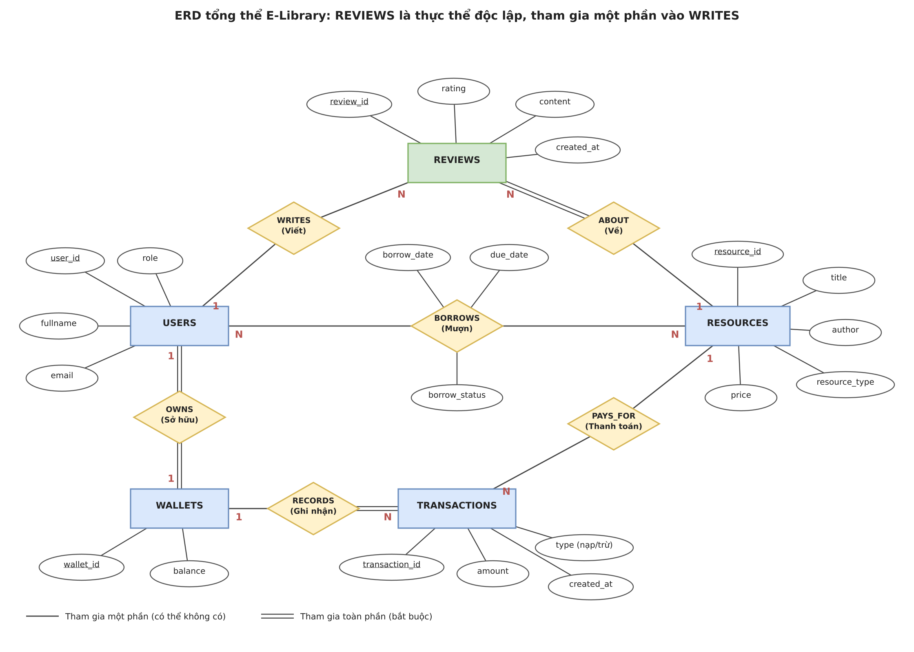

# Bài tập: Bản thiết kế Kiến trúc E-Library (Thư viện số)

## 1. Thiết kế tổng thể



[Mở sơ đồ trên draw.io](https://app.diagrams.net/#RzZvLbttGFIZfhWCBIAGamBxeRFdhAMdREwOJVUhOjK6MITkSiYxIYTiUrO6KPkEXXXTVBF10UQRtt9aiixR9D71Jh3fKpRtVQwr0wuBV%2FL8zZ%2F4ZkoePZ9cTDyPBDUJqinA%2Bf%2BR4cErgLHzkIyo%2BeZytCj6cIVMcjJ49HDx86VkEkpUoeI4pIuxZ7LjZ9XMC5%2B6rwEFYcK5NUVYlSRSclSkexwtTEh8spwtj7xv2YzLbPIdTlGyOFy49h7rxmVq25wXypi6Nj2Q%2F8eQxCQIaX%2BkUYZxcWxKPttaT3yHIp%2F%2FeRT2KkSgsII5SDoFu1j%2F4U4G6m%2FV3QgH1hTAavDkbXI4F%2FPFdsvMPOzvmr%2B836x9tAW9uPsw%2FZ9tYVKYeFGZsKxXm7ubmF19YfHwXCJejs4vBWBRCusLsYhRd075LZ9iU%2BxB7U9%2B0mURE%2BpPAp%2BPkGDldjsMi630mExF21haQnAYZBTNEyUq4jhGFVfJ%2FmcctDrSbxUxhyzA0xWl2RhyPozQgW4GJQkTCIjCvx4NRqZwEke8gx5T6S9ejaDyHNjKXrJ1znHoCtc9yCp8GOCDmZw5ExsTuh5QEb1G2TbcNZE125QRSSqr2KqxaBVXfEZWgMIiIjUrc0WA8fD06HXQNWZa0GmZ9L%2BaFh5ZV4iS7m%2BXVkOGo27wGsBR951TWgZbgAsDZxEuIMaIl7uXJy5eDi65mdE%2FjxKUE%2BiG0qRf4JfPF6OR8fHJ6cTY87xq4LteAG%2Fu0M2EQlWZOHPcepn2L3JvS%2Fv033ubmT%2FqgxHeDmRWFd8KXkJPJBNi3IB3d0jX9jhCBXeEVI4VX5C3PLuGNHeGhFUS0YD95Onx9UUXfrL%2FtFrjRawjcCggJKmb2dDgaDS%2Br7f7q798365%2F9bvHrSmbmOid%2FsKx08%2BHleZV8vFn%2FJLB5ym9Rt%2BCBlFq7LnHCE2QHxKmOZKfD0bNqCJ67nuCzediHjrW%2FmrueyhmCOVyV%2FF%2BdfD2%2B%2BnI4qgTgwoW%2BK9Dg43u%2Fmw6g8zpAJBf8MXcUY8cz2CvPidePkg0FOjvLm4foP4e8%2F9mUmZMZFQ5Q4VB35QAFxyTCOL67alF17j%2FcqpVCNZpBD7cfaK1qmfI%2BktVCMglwm0GWjZrckPaQvKjJ8XQaf7Asz7qrXDUsZR%2BUMs0JpJ4%2FbVG0nqWMDDhTZlFmuc1ksMu1qLp3XBPqffrmokx0myBIkXMF2xRugFQ4kDlzhNSme3qnfqiElyU967y9OwaonWnKjM8eObUnGuS%2BLnNmPCkzHkbUDUirqrN%2Bqh7zqq5Ye54vdDVvN%2BRZ1mt3PYvaWbxWiJ8Tz25VtJSNTBpvxK2yq6a3YlcOM5oWpWtFt9T4TMYqu6UTobZl90CN7H1M3VJuBzykkEZhm8OoUpMs%2BzjhssbX08dzh3L1LHkMjXOEWpbJY0EM%2FVZ7a27qhs45IaA18a88LzxUI2igphX0fXjKVoAz9jSz1VmZVNMI%2BzgmLTtwPDQJ9%2F3Nzfv5ESWb9a8PDjA7MwDnOEUPPa3MZgeGwdlpkVSq9J2T2DxNP%2FBRrk0UkFO8e8zVCOk0In3OQCGZIpq%2FIdsSShBmtzOL9PSd1MhcakDDagCXGqVhNQqXGrVhNSqPmkUlb%2FJXb5x6NC49oHE9OpcepXE9PS49auN6DB49ZCt%2F8tfVnIqOuRSBFhTJXOZMlDYkcTk0UduQxGXT8R1m85K4vNqqZHf%2BLo9XEJddW6B5QVx%2BbSnNC%2BIy7GWlyfLiCl5BXI69BM0L4rJsWonQVj0Gryou26agHVWAy7mp0pIqLvOmakuqyjvWT%2Birf72qJcvZi1jL0FhdZB9DC%2BGn0H47TSp6yje37O9TM%2BW00q%2FoPGkJDS9jeYN73gHGvC6o4TkdUA9MGbpwjkzs%2BW8%2FNcrn9X05cVocxMurdSpzs4KnxmczQO9U8t7qoA2N%2F6DXKciihqv51jQOnLQ7d9JbDZuUcfHCHncVNi1Sa3iKFj8B7JAhFWXGZRKnxWm8mHJ3x5ms%2Bq6NiZICOmVR21XVOXBSfMcLqnQqjdN6wkaM%2BCj9OOeo%2Bh0QW80%2BH0p2xB8aPfkH)

### Thực thể và thuộc tính (thuộc tính định danh được gạch chân)

| Thực thể | Thuộc tính |
|---|---|
| USERS | <u>user_id</u>, fullname, email, role (sinh viên / giảng viên) |
| RESOURCES | <u>resource_id</u>, title, author, resource_type (sách vật lý / e-book / bài báo khoa học), price |
| WALLETS | <u>wallet_id</u>, balance (số dư hiện tại) |
| TRANSACTIONS | <u>transaction_id</u>, amount, type (nạp / trừ), created_at |
| REVIEWS | <u>review_id</u>, rating, content, created_at |

- USERS gộp cả sinh viên và giảng viên, phân biệt bằng thuộc tính **role**, vì hai nhóm này dùng chung các chức năng mượn, đọc, đánh giá và ví.
- RESOURCES gộp cả 3 loại tài liệu, phân biệt bằng **resource_type**. Sách vật lý dùng cho việc mượn; e-book và bài báo khoa học có **price** để mua quyền xem.
- Ví được tách làm hai phần: **WALLETS** lưu số dư, còn **TRANSACTIONS** lưu lịch sử từng lần nạp hoặc trừ tiền.

### Mối quan hệ

| Mối quan hệ | Nối giữa | Lực lượng | Ghi chú |
|---|---|---|---|
| OWNS (Sở hữu) | USERS – WALLETS | 1 – 1 | Mỗi người dùng có đúng một ví |
| RECORDS (Ghi nhận) | WALLETS – TRANSACTIONS | 1 – N | Mỗi giao dịch bắt buộc thuộc về một ví |
| PAYS_FOR (Thanh toán) | TRANSACTIONS – RESOURCES | N – 1 | Giao dịch trừ tiền khi mua quyền xem bài báo hoặc e-book. Giao dịch nạp tiền không gắn với tài liệu nào (tham gia một phần) |
| BORROWS (Mượn) | USERS – RESOURCES | N – N | Mượn sách vật lý, có thuộc tính borrow_date, due_date, borrow_status |
| WRITES (Viết) | USERS – REVIEWS | 1 – N | **REVIEWS tham gia một phần**: một đánh giá có thể không còn người viết |
| ABOUT (Về) | REVIEWS – RESOURCES | N – 1 | REVIEWS tham gia toàn phần: mỗi đánh giá bắt buộc gắn với một tài liệu |

## 2. Giải quyết ngoại lệ: Xóa người dùng nhưng vẫn giữ bình luận

**Ý tưởng:** tách bình luận thành **thực thể REVIEWS độc lập**, không phải thuộc tính của USERS.

1. **REVIEWS là thực thể mạnh, có khóa riêng là <u>review_id</u>.** Nếu nội dung đánh giá chỉ là thuộc tính gắn trên USERS, hoặc REVIEWS là thực thể yếu phụ thuộc vào USERS, thì xóa người dùng sẽ kéo theo mất luôn bình luận. Khi REVIEWS có khóa riêng, nó tồn tại độc lập với người viết.
2. **REVIEWS tham gia một phần vào WRITES** (nét đơn trên sơ đồ). Một đánh giá *có thể không có* người viết, nên khi người dùng bị xóa, đánh giá vẫn hợp lệ.
3. **REVIEWS tham gia toàn phần vào ABOUT** (nét đôi trên sơ đồ). Đánh giá luôn gắn với một tài liệu, nên người khác vẫn đọc được đánh giá khi xem tài liệu đó.

**Khi chuyển sang bảng:**

| Bảng | Cột |
|---|---|
| REVIEWS | **review_id** (PK), user_id (FK → USERS, **cho phép NULL**), resource_id (FK → RESOURCES, NOT NULL), rating, content, created_at |

Khóa ngoại `user_id` được khai báo với **ON DELETE SET NULL**:

```sql
CREATE TABLE REVIEWS (
  review_id   INT PRIMARY KEY AUTO_INCREMENT,
  user_id     INT NULL,
  resource_id INT NOT NULL,
  rating      TINYINT,
  content     TEXT,
  created_at  DATETIME,
  FOREIGN KEY (user_id) REFERENCES USERS(user_id) ON DELETE SET NULL,
  FOREIGN KEY (resource_id) REFERENCES RESOURCES(resource_id)
);
```

Khi tài khoản sinh viên bị xóa, các đánh giá của họ **không bị xóa theo**, chỉ có `user_id` chuyển thành NULL. Giao diện hiển thị những đánh giá này dưới tên **"Người dùng đã xóa"**, nên nội dung vẫn còn cho người khác tham khảo nhưng không lộ tên sinh viên.
